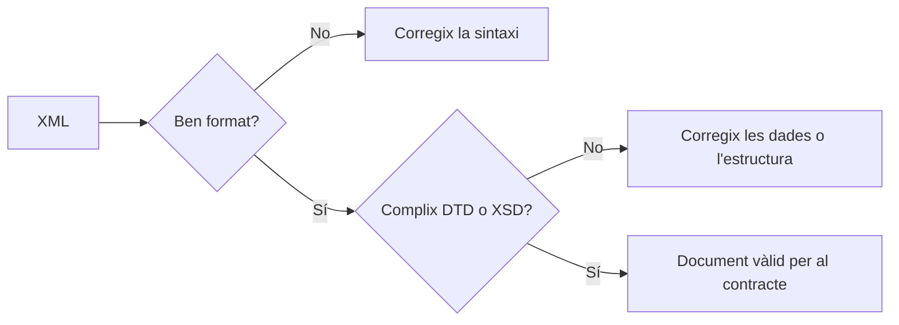

# 4. Validació XML: DTD i XSD

En esta unitat, de **tres setmanes orientatives**, convertiràs les decisions de modelatge del catàleg de TecnoRiu en regles que una eina pot comprovar. És una proposta metodològica vinculada a l'[itinerari del curs](index.md), no una temporalització oficial.

<div class="grid cards" markdown>

-   **Punt de partida**

    ---

    Disposes del `cataleg.xml` de la unitat 3: usa l'espai de noms per defecte `https://tecnoriu.example/ns/cataleg`, el prefix `dc`, productes repetibles, `codi`, `moneda`, `nom`, `preu` i `disponible`.

-   **Producció final**

    ---

    Lliuraràs un contracte `cataleg.xsd`, un catàleg que el complix, una mostra que falla expressament i un registre de proves amb les ordres i els resultats de validació.

</div>

## Propòsit i resultats observables

La **validació XML** comprova si un document ben format respecta un contracte de dades. El contracte pot indicar quins elements existixen, en quin orde apareixen, quantes vegades es repetixen o quins valors poden prendre. Això permet detectar errors abans que el catàleg arribe a una altra aplicació.

La unitat continua el treball d'[XML i espais de noms](03-xml.md) i es relaciona, de manera orientativa, amb els **RA1 i RA4** indicats en l'itinerari. No establix criteris d'avaluació ni substituïx la programació oficial.

En acabar podràs:

- [ ] diferenciar una comprovació de bona formació d'una validació amb DTD o XSD;
- [ ] descriure amb una DTD externa una estructura elemental, atributs obligatoris i una enumeració;
- [ ] explicar per què una DTD és útil en documents de llegat però insuficient per al catàleg amb namespaces;
- [ ] escriure un XSD amb `targetNamespace`, elements qualificats, tipus i restriccions;
- [ ] restringir `codi`, `preu`, `moneda` i `disponible` segons les regles de TecnoRiu;
- [ ] vincular un XML amb el seu esquema i validar-lo amb `xmllint`;
- [ ] interpretar un error de validació i documentar un cas vàlid i un altre d'invàlid.

!!! note "Abast"
    Treballarem DTD, XSD, validació, casos de prova i diagnòstic. No treballarem XPath ni XSLT: la selecció de nodes i les transformacions s'abordaran en la unitat 5. Per esta raó, tampoc usarem `xs:key`, ja que la seua definició requerix expressions XPath.

## Activació: regles que la bona formació no pot exigir

El catàleg següent pot estar perfectament ben format: té una única arrel, les etiquetes estan tancades i el prefix `dc` està declarat. Però seria un mal catàleg per a TecnoRiu.

```xml
<?xml version="1.0" encoding="UTF-8"?>
<cataleg xmlns="https://tecnoriu.example/ns/cataleg"
          xmlns:dc="http://purl.org/dc/terms/">
  <dc:title>Catàleg de TecnoRiu</dc:title>
  <dc:creator>TecnoRiu</dc:creator>
  <dc:language>ca</dc:language>
  <producte codi="teclat-blau">
    <nom>Teclat compacte</nom>
    <preu moneda="GBP">gratuït</preu>
    <disponible>potser</disponible>
  </producte>
</cataleg>
```

Quines regles necessitem que una eina impose?

- `codi` ha de tindre la forma `TR-` seguida de tres xifres, com `TR-101`.
- `preu` ha de ser un decimal igual o superior a zero.
- `moneda` sols pot ser `EUR` o `USD`.
- `disponible` sols pot ser `sí` o `no`.
- Les metadades i les dades de cada producte han d'aparéixer en l'orde acordat.

Cap d'estes condicions és una regla de sintaxi XML. Per tant, cal un contracte extern.

| Comprovació | Pregunta que respon | Exemple d'error que detecta |
|---|---|---|
| **Bona formació** | El document és XML sintàcticament correcte? | Etiquetes mal imbricades o un `&` sense escapar. |
| **Validació DTD** | Respecta una estructura i uns atributs definits en una DTD? | Falta `codi`, sobra un fill o `moneda="GBP"`. |
| **Validació XSD** | Respecta estructura, namespaces, tipus i restriccions de l'esquema? | `codi="teclat-blau"`, `preu="gratuït"` o `disponible="potser"`. |



*Alternativa textual: primer un parser comprova la sintaxi XML. Només si esta és correcta té sentit validar el document contra una DTD o un XSD; després, el document pot ser vàlid o requerir correccions de dades o estructura.*

## 1. DTD: un contracte estructural de llegat

Una **DTD** (*Document Type Definition*) és una manera clàssica de declarar l'estructura permesa d'un XML. Encara apareix en integracions antigues i en alguns formats publicats fa anys, de manera que convé saber llegir-la i mantindre'n una de senzilla.

### Elements, orde, repetició i atributs

En esta DTD reduïda no usem namespaces: es concentra en la sintaxi bàsica de DTD. `,` exigix una seqüència, `+` indica una o més repeticions i `#PCDATA` significa text analitzat pel parser.

```dtd title="cataleg.dtd"
<!ELEMENT cataleg (producte+)>
<!ELEMENT producte (nom, preu, disponible)>
<!ATTLIST producte codi CDATA #REQUIRED>
<!ELEMENT nom (#PCDATA)>
<!ELEMENT preu (#PCDATA)>
<!ATTLIST preu moneda (EUR | USD) #REQUIRED>
<!ELEMENT disponible (#PCDATA)>
```

| Declaració | Regla que expressa |
|---|---|
| `<!ELEMENT cataleg (producte+)>` | L'arrel conté un o més productes. |
| `<!ELEMENT producte (nom, preu, disponible)>` | Els tres fills són obligatoris i apareixen exactament en este orde. |
| `<!ATTLIST producte codi CDATA #REQUIRED>` | `codi` és un atribut de text obligatori. |
| `moneda (EUR \| USD) #REQUIRED` | `moneda` és obligatòria i només admet els dos valors enumerats. |

`CDATA` no significa «dada numèrica»: en una DTD és text. Així, esta DTD no pot exigir per si mateixa que `39.90` siga decimal ni que `disponible` siga només `sí` o `no` com a contingut de l'element.

### Exemple guiat: DTD externa i validació

Guarda els dos fitxers següents en la mateixa carpeta. La declaració `DOCTYPE` enllaça el document amb la DTD externa. El nom de l'arrel, `cataleg`, ha de coincidir amb la declaració de la DTD.

```xml title="cataleg-dtd.xml"
<?xml version="1.0" encoding="UTF-8"?>
<!DOCTYPE cataleg SYSTEM "cataleg.dtd">
<cataleg>
  <producte codi="TR-101">
    <nom>Teclat compacte</nom>
    <preu moneda="EUR">39.90</preu>
    <disponible>sí</disponible>
  </producte>
</cataleg>
```

Executa esta ordre des de la carpeta que conté els fitxers:

```console
xmllint --noout --dtdvalid cataleg.dtd cataleg-dtd.xml
```

`--noout` evita que l'eina torne a imprimir l'XML. `--dtdvalid cataleg.dtd` demana validar contra eixa DTD. Si l'ordre no mostra cap missatge i acaba correctament, la mostra és vàlida respecte de la DTD. En canvi, `xmllint --noout cataleg-dtd.xml` només comprovaria la bona formació; no aplicaria el contracte.

!!! warning "Valida només fitxers de confiança"
    Usa estes ordres amb els fitxers locals de l'activitat o amb fitxers d'origen conegut. No actives la càrrega de DTD o entitats externes en XML desconegut: podrien intentar llegir recursos que no formen part de la pràctica. Si has de treballar amb un fitxer extern, consulta primer la documentació de l'eina i aplica les restriccions de seguretat que corresponguen.

!!! warning "Límits de DTD"
    Les DTD no tenen tipus de dades rics: no poden expressar de forma adequada «decimal no negatiu» ni el patró `TR-[0-9]{3}`. Tampoc gestionen els namespaces XML de manera nativa. En una DTD, `dc:title` és només un nom amb dos punts, no un nom associat formalment a un URI. Per al catàleg real de TecnoRiu usarem XSD.

## 2. XSD: un contracte amb namespaces i tipus

**XSD** (*XML Schema Definition*) és un llenguatge basat en XML per descriure documents XML. Permet definir la jerarquia i, a més, tipus com `xs:decimal`, patrons, mínims i enumeracions.

### Decisions de l'esquema de TecnoRiu

| Decisió | Expressió en XSD | Per què |
|---|---|---|
| Vocabulari propi | `targetNamespace="https://tecnoriu.example/ns/cataleg"` | L'esquema regula els elements de TecnoRiu. |
| Elements amb namespace | `elementFormDefault="qualified"` | Els elements locals del catàleg han d'estar qualificats amb el namespace objectiu. |
| Codi | `xs:pattern value="TR-[0-9]{3}"` | Evita codis arbitràriament escrits. |
| Preu | `xs:decimal` + `xs:minInclusive value="0"` | Admet decimals i exclou imports negatius. |
| Moneda | `xs:enumeration` | El contracte admet solament `EUR` i `USD`. |
| Disponibilitat | `xs:enumeration` | La dada té dos estats acordats: `sí` i `no`. |

### L'esquema complet

Este esquema reserva exactament tres posicions de metadades Dublin Core abans dels productes. Com que no importem un esquema remot de Dublin Core, usem una única partícula `xs:any` amb `processContents="lax"`: l'eina comprova que els tres elements són del namespace Dublin Core, però no pot verificar-ne el nom local o el contingut contra un esquema que no té.

```xml title="cataleg.xsd"
<?xml version="1.0" encoding="UTF-8"?>
<xs:schema xmlns:xs="http://www.w3.org/2001/XMLSchema"
           targetNamespace="https://tecnoriu.example/ns/cataleg"
           xmlns="https://tecnoriu.example/ns/cataleg"
           elementFormDefault="qualified">

  <xs:element name="cataleg">
    <xs:complexType>
      <xs:sequence>
        <xs:any namespace="http://purl.org/dc/terms/" processContents="lax" minOccurs="3" maxOccurs="3"/>
        <xs:element name="producte" type="ProducteType" minOccurs="1" maxOccurs="unbounded"/>
      </xs:sequence>
    </xs:complexType>
  </xs:element>

  <xs:complexType name="ProducteType">
    <xs:sequence>
      <xs:element name="nom" type="xs:string"/>
      <xs:element name="preu">
        <xs:complexType>
          <xs:simpleContent>
            <xs:extension base="PreuType">
              <xs:attribute name="moneda" type="MonedaType" use="required"/>
            </xs:extension>
          </xs:simpleContent>
        </xs:complexType>
      </xs:element>
      <xs:element name="disponible" type="DisponibilitatType"/>
    </xs:sequence>
    <xs:attribute name="codi" type="CodiType" use="required"/>
  </xs:complexType>

  <xs:simpleType name="CodiType">
    <xs:restriction base="xs:string">
      <xs:pattern value="TR-[0-9]{3}"/>
    </xs:restriction>
  </xs:simpleType>

  <xs:simpleType name="PreuType">
    <xs:restriction base="xs:decimal">
      <xs:minInclusive value="0"/>
    </xs:restriction>
  </xs:simpleType>

  <xs:simpleType name="MonedaType">
    <xs:restriction base="xs:string">
      <xs:enumeration value="EUR"/>
      <xs:enumeration value="USD"/>
    </xs:restriction>
  </xs:simpleType>

  <xs:simpleType name="DisponibilitatType">
    <xs:restriction base="xs:string">
      <xs:enumeration value="sí"/>
      <xs:enumeration value="no"/>
    </xs:restriction>
  </xs:simpleType>
</xs:schema>
```

!!! note "Límit deliberat de les metadades"
    La partícula `xs:any` limita a **tres** metadades Dublin Core, abans dels productes. Això permet que `dc:title`, `dc:creator` i `dc:language` apareguen en el XML de la unitat 3, sense descarregar ni importar cap XSD remot. Sense l'esquema de Dublin Core, XSD no pot distingir tècnicament `dc:title` d'un altre element del mateix namespace ni imposar-ne l'orde; és un límit conegut i documentat del nostre contracte local.

### XML vinculat a l'XSD i validació

`xsi:schemaLocation` és una pista formada per parelles «URI de namespace + ubicació de l'esquema». En este cas relaciona el namespace de TecnoRiu amb el fitxer local `cataleg.xsd`. L'ordre següent usa igualment `--schema` de manera explícita, fet que la fa reproduïble.

```xml title="cataleg.xml"
<?xml version="1.0" encoding="UTF-8"?>
<cataleg xmlns="https://tecnoriu.example/ns/cataleg"
          xmlns:dc="http://purl.org/dc/terms/"
          xmlns:xsi="http://www.w3.org/2001/XMLSchema-instance"
          xsi:schemaLocation="https://tecnoriu.example/ns/cataleg cataleg.xsd">
  <dc:title>Catàleg de TecnoRiu</dc:title>
  <dc:creator>TecnoRiu</dc:creator>
  <dc:language>ca</dc:language>
  <producte codi="TR-101">
    <nom>Teclat compacte</nom>
    <preu moneda="EUR">39.90</preu>
    <disponible>sí</disponible>
  </producte>
  <producte codi="TR-205">
    <nom>Ratolí vertical</nom>
    <preu moneda="USD">29.50</preu>
    <disponible>no</disponible>
  </producte>
</cataleg>
```

```console
xmllint --noout --schema cataleg.xsd cataleg.xml
```

Quan és correcte, `xmllint` informa en l'eixida d'error estàndard que `cataleg.xml validates`. Amb `--schema`, `xmllint` també ha d'analitzar primer la bona formació: si hi ha un error sintàctic, no arribarà a validar l'XSD.

## Diagnòstic: de l'error a la regla incomplida

Un missatge de validació sol indicar la línia on s'ha manifestat el problema i el nom de l'element o atribut implicat. No el tractes com una resposta opaca: identifica la regla de l'esquema que s'ha incomplert, fes una correcció mínima i repetix la mateixa ordre.

| Símptoma o missatge aproximat | Causa probable | Estratègia de diagnòstic |
|---|---|---|
| `value ... is not accepted by the pattern` | `codi` no té forma `TR-` + tres xifres. | Compara el valor amb `TR-[0-9]{3}`; `TR-007` és vàlid i `TR-7` no. |
| `is not a valid value of the atomic type 'xs:decimal'` | El contingut de `preu` no és decimal. | Usa xifres i punt decimal, per exemple `39.90`; elimina símbols de moneda i text. |
| `facet 'minInclusive'` | El preu és inferior a zero. | Mantín `0` o un valor superior; la moneda va a l'atribut. |
| `Enumeration` o `not a valid value` | `moneda` o `disponible` usa un valor fora de la llista. | Escriu exactament `EUR` o `USD`, i `sí` o `no`, respectant accents i majúscules. |
| `Missing child element` o error de contingut | Falta un fill, n'hi ha un de sobrant o l'orde és incorrecte. | Revisa `nom`, `preu`, `disponible` i l'orde de la seqüència. |
| Error de namespace o element no declarat | Falta el namespace per defecte, `dc` apunta a un URI erroni o s'ha canviat un nom. | Compara les declaracions `xmlns` amb el XML model i amb `targetNamespace`. |
| `failed to load external entity` | La ruta de `cataleg.xsd` o `cataleg.dtd` no és accessible des de la carpeta actual. | Confirma el nom del fitxer i executa l'ordre des de la carpeta que els conté. |

!!! tip "Aïlla la prova"
    Conserva sempre una mostra vàlida. Per a investigar un error, crea una còpia i modifica una sola dada. Si canvies patró, preu i estructura alhora, no podràs atribuir el resultat a una regla concreta.

## Pràctica graduada

### 1. Llegir un contracte DTD

**Objectiu:** relacionar cada construcció d'una DTD amb una restricció observable.

**Punt de partida:** usa `cataleg.dtd` i `cataleg-dtd.xml` de l'exemple guiat.

1. Fes una còpia anomenada `cataleg-dtd-invalid.xml`.
2. Canvia `moneda="EUR"` per `moneda="GBP"` i executa `xmllint --noout --dtdvalid cataleg.dtd cataleg-dtd-invalid.xml`.
3. Restaura la moneda, elimina l'atribut `codi` i repetix la prova.
4. En un registre, anota per a cada cas la regla DTD vulnerada i el missatge observat.

**Resultat observable:** les dos mostres continuen sent XML ben format, però fallen la validació DTD per causes diferents.

**Criteris d'èxit:**

- [ ] Has distingit una enumeració d'atribut de `#REQUIRED`.
- [ ] Has mantingut una còpia vàlida sense modificar.
- [ ] El registre associa cada error a una declaració concreta de la DTD.

### 2. Corregir mostres invàlides amb XSD

**Objectiu:** diagnosticar dades que incompleixen un tipus o una restricció XSD.

**Punt de partida:** guarda `cataleg.xsd` i el `cataleg.xml` vàlid de l'exemple.

Valida cada fragment després de substituir només el valor indicat en una còpia del catàleg. No canvies encara l'esquema.

| Cas invàlid | Regla que has d'identificar | Resultat després de corregir |
|---|---|---|
| `codi="TR-12"` | Patró de tres xifres. | El codi té la forma `TR-` seguida de tres xifres. |
| `<preu moneda="EUR">-2.50</preu>` | Decimal no negatiu. | El preu és `0` o superior. |
| `<preu moneda="GBP">39.90</preu>` | Enumeració de moneda. | La moneda és `EUR` o `USD`. |
| `<disponible>pendent</disponible>` | Enumeració de disponibilitat. | El valor és `sí` o `no`. |

**Resultat observable:** cada còpia falla amb `xmllint --noout --schema cataleg.xsd nom-de-la-copia.xml` abans de la correcció i valida després de corregir només la causa indicada.

**Criteris d'èxit:**

- [ ] Per a cada cas, has anotat la línia del missatge i la regla corresponent de l'XSD.
- [ ] No has «resolt» l'error eliminant el producte o relaxant l'esquema.
- [ ] Les correccions conserven els namespaces i l'orde dels elements.

### 3. Comprovar estructura i metadades

**Objectiu:** observar que un contracte també imposa orde i quantitat d'elements.

**Punt de partida:** una còpia vàlida de `cataleg.xml`.

1. Intercanvia `nom` i `preu` dins d'un producte; valida i interpreta el missatge.
2. Elimina `dc:language`; valida i identifica que l'esquema exigix tres elements del namespace Dublin Core. Pots saber que falta concretament `dc:language` en comparar la còpia amb la mostra base, no a partir del missatge de l'XSD.
3. Restaura cada còpia abans de passar a la prova següent.

**Resultat observable:** els dos documents fallen la validació XSD encara que continuen ben formats.

## Minirepte: contracte verificable del catàleg

**Objectiu:** preparar i provar un contracte XSD local perquè una aplicació puga rebutjar automàticament catàlegs que no respecten les regles acordades.

**Punt de partida:** l'XSD de l'exemple guiat i el teu catàleg de TecnoRiu de la unitat 3.

**Fitxers esperats:**

```text
cataleg.xsd
cataleg-valid.xml
cataleg-invalid.xml
registre-validacio.txt
```

1. Adapta o reescriu `cataleg.xsd` perquè conserve el namespace `https://tecnoriu.example/ns/cataleg`, les tres metadades Dublin Core i l'estructura de producte indicada en la unitat.
2. Crea `cataleg-valid.xml` amb dos o més productes, `xsi:schemaLocation`, codis amb forma `TR-` seguida de tres xifres, preus no negatius, moneda `EUR` o `USD` i disponibilitat `sí` o `no`. Usa codis diferents com a dada de prova, però recorda que l'XSD d'esta unitat no en pot comprovar la unicitat: `xs:key` s'estudiarà quan es treballe XPath.
3. Crea `cataleg-invalid.xml` a partir del vàlid i introduïx **una única** infracció deliberada: patró de codi, preu, moneda, disponibilitat o orde.
4. En `registre-validacio.txt`, anota l'ordre exacta emprada per a cada XML, el resultat observat, la regla comprovada i la correcció proposada per al cas invàlid.

**Criteris d'èxit:**

- [ ] `xmllint --noout --schema cataleg.xsd cataleg-valid.xml` valida el cas vàlid.
- [ ] La mateixa ordre aplicada a `cataleg-invalid.xml` falla per la infracció que has documentat.
- [ ] El XSD usa `targetNamespace` i `elementFormDefault="qualified"` de forma coherent amb l'XML.
- [ ] `codi`, `preu`, `moneda` i `disponible` tenen les restriccions acordades.
- [ ] He comprovat manualment que els codis de la mostra de prova són diferents; la unicitat encara no forma part del contracte XSD.
- [ ] El registre permet reproduir les dos proves sense necessitat de consultar-te.

## Autoavaluació

Intenta respondre abans de desplegar cada solució.

1. Un XML és ben format; pot continuar sent invàlid? Posa un exemple.

    ??? success "Solució"
        Sí. Pot tindre totes les etiquetes ben tancades però incloure `<disponible>potser</disponible>`. La sintaxi XML és correcta, però l'XSD de TecnoRiu només permet `sí` o `no`.

2. Què expressa `+` en `<!ELEMENT cataleg (producte+)>`?

    ??? success "Solució"
        Que `cataleg` ha de contindre un o més elements `producte`. No admet un catàleg buit segons eixa DTD.

3. Per què `CDATA` en una DTD no garantix que el preu siga numèric?

    ??? success "Solució"
        Perquè `CDATA` és text. Una DTD pot exigir que existisca l'atribut, però no aplicar un tipus decimal ni un mínim numèric al contingut de `preu`.

4. Quina restricció XSD rebutja `TR-7` i accepta `TR-007`?

    ??? success "Solució"
        El patró `TR-[0-9]{3}`. Després de `TR-` requerix exactament tres xifres.

5. Per què l'XSD usa tres `xs:any` per a les metadades Dublin Core en lloc de definir `dc:title` directament?

    ??? success "Solució"
        Perquè no importem l'esquema Dublin Core remot. La partícula accepta exactament tres elements d'eixe namespace amb validació laxa; no pot comprovar el nom local concret ni l'orde sense disposar d'eixe altre esquema.

6. Quina ordre valida el catàleg amb l'XSD local?

    ??? success "Solució"
        `xmllint --noout --schema cataleg.xsd cataleg.xml`. `--schema` indica el contracte XSD i `--noout` evita imprimir el document validat.

## Resum operatiu i recursos

**Comprova la bona formació → aplica el contracte DTD o XSD → relaciona cada error amb una regla → corregix una causa → repetix i registra la prova.**

- Un XML ben format respecta la sintaxi; un XML vàlid respecta, a més, un contracte concret.
- DTD és una tecnologia de llegat útil per a estructures senzilles, però no aporta tipus numèrics ni suport real de namespaces.
- XSD permet declarar namespace objectiu, seqüències, repeticions, tipus, patrons, mínims i enumeracions.
- `xmllint --noout --dtdvalid cataleg.dtd cataleg-dtd.xml` valida una DTD externa; `xmllint --noout --schema cataleg.xsd cataleg.xml` valida un XSD.
- Una prova vàlida i una d'invàlida, amb registre reproduïble, demostren que el contracte funciona.

### Recursos per continuar

- [W3C: XML 1.0](https://www.w3.org/TR/xml/): especificació sobre sintaxi XML i declaracions `DOCTYPE`.
- [W3C: XML Schema Part 0: Primer](https://www.w3.org/TR/xmlschema-0/): visió general de XSD, namespaces i validació.
- [W3C: XML Schema Part 2: Datatypes](https://www.w3.org/TR/xmlschema-2/): tipus com `xs:decimal` i facetes com `pattern`, `enumeration` i `minInclusive`.
- [W3C: XML Schema Part 1: Structures](https://www.w3.org/TR/xmlschema-1/): seqüències, atributs, namespaces i `xs:any`.
- [Documentació de `xmllint` a libxml2](https://gnome.pages.gitlab.gnome.org/libxml2/xmllint.html): opcions de línia d'ordres per analitzar i validar XML.
- [Unitat 5](05-xpath-xslt.md): selecció de nodes i transformacions amb XPath i XSLT.
